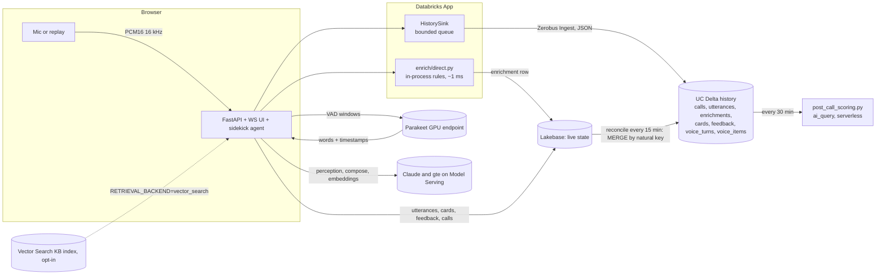

# Realtime Call Sidekick

Live call audio becomes sub-second transcripts. The app enriches each final utterance and turns it into
suggestion cards for the agent or advisor, pushed over WebSocket. Two-way voice mode runs in the same app.
Contract: [`docs/SPEC.md`](docs/SPEC.md). Architecture, both backbones, latency budget and switching:
[`docs/ARCHITECTURE.md`](docs/ARCHITECTURE.md).

## Command line: `sidekick`

```bash
ln -s "$PWD/scripts/sidekick" ~/.local/bin/sidekick   # once
sidekick on       # demo mode: voice GPUs always-on, no cold start (bills while on) — ~8 min to apply
sidekick off      # back to scale-to-zero — ~7 min
sidekick status   # readiness + scale-to-zero per endpoint
sidekick warm     # wake the voice endpoints now
sidekick open     # open the app;  sidekick health | test | logs | deploy
```

## Try it

Deployed (FEVM `realtime-call-sidekick`, AWS us-west-2, Databricks SSO):
**https://call-sidekick-7474650324322090.aws.databricksapps.com**

1. Put on headphones (otherwise Sidekick hears itself).
2. GPU endpoints scale to zero: run `scripts/warmup_voice.py --profile realtime-call-sidekick` first, or let the app
   warm them (opening a voice session pings both; the banner shows "Warming up voice" for up to ~2 minutes).
3. Start screen → **Talk to Sidekick** → **Practice customer** → *fee objection* (the customer talks back while
   Sidekick coaches you), or **Assistant** (ask it what to say next; it answers aloud and files outcomes).
   Deep links: `/?autostart=1&voice=practice&scenario=fee_objection`, `/?autostart=1&voice=assistant`.
4. While you talk: live caption, live read (sentiment, intent, objections), live suggestion chips (pin to keep).
   After each turn: spoken reply, Outcomes (action items, follow-up questions and responses, next steps), copy as email.

End-to-end check from a laptop (streams synthesized speech in and saves Sidekick's spoken reply as a WAV):
`.venv/bin/python scripts/voice_smoke.py --profile realtime-call-sidekick [--role practice]`.

## Architecture

The default backbone is **direct**: no Kafka. The app enriches each final in process, keeps live state in
Lakebase, and writes history to Delta through **Zerobus Ingest**.



ASCII summary:

```
direct (default)   final ─► enrich in process ─► Lakebase (live) ─► cards over WS
                       └──► HistorySink ─► Zerobus ─► UC Delta (history)            no broker, no RTM
kafka (scale mode) final ─► Kafka utterances ─► RTM job (classic) ─► Lakebase ─► NOTIFY ─► cards
                       └──► Kafka cards ─► delta_history.py (5 s) ─► UC bronze      needs classic workspace
```

## Which backbone?

| | direct (default) | kafka (scale mode) |
|---|---|---|
| Use for | demos, POCs, most customers | customers on Kafka/Event Hubs/MSK, fan-out, many concurrent calls |
| Broker | none | required |
| Classic compute | not needed (serverless) | RTM and history job need classic |
| Deploy | `scripts/deploy.sh <profile> <catalog>` | `BACKBONE=kafka scripts/deploy.sh ...` (bundle target `kafka`) |

Full comparison, latency budget and cost table: [`docs/ARCHITECTURE.md`](docs/ARCHITECTURE.md).

## Quickstart (local, no Databricks)

```bash
uv venv .venv --python 3.11
uv pip install -r src/app/requirements.txt -r tests/app/requirements-dev.txt --python .venv/bin/python
cd src/app && MODE=local uvicorn main:app --port 8000        # direct backbone, memory store and history
```

Local mode uses the in-memory store, the in-memory history sink, and no bus. Set `DATABRICKS_CONFIG_PROFILE`
to a workspace profile to use its LLM endpoints (`realtime-call-sidekick`). Without it, the LLM is off and cards use
templates. Voice needs the Parakeet and Kokoro endpoints, so test it against the deployed app (`voice_smoke.py`).

`BACKBONE=kafka MODE=local` runs the scale-mode code path locally: an in-memory bus stands in for Kafka and
`enrich/direct.py`'s `BusEnricher` stands in for RTM.

## Deploy

Deployment is one script. Prerequisites: the Databricks CLI with a profile for the target workspace, `jq`,
`openssl`, and permission to create apps, jobs, UC schemas and secret scopes, plus serving endpoints if you want voice.

### Direct backbone (default)

Create the Zerobus service principal first (Workspace access entitlement), then:

```bash
export DATABRICKS_CONFIG_PROFILE=<profile>
export ZEROBUS_ENDPOINT=<workspace-id>.zerobus.<region>.cloud.databricks.com   # from the workspace
export ZEROBUS_CLIENT_ID=<service principal application id>
export ZEROBUS_CLIENT_SECRET=<oauth secret>        # read from your vault, never commit it
scripts/deploy.sh <profile> <catalog>               # BACKBONE=direct is the default
```

The script writes the Zerobus values to the secret scope (`call-sidekick` by default; `zerobus_client_secret` is never
printed), validates and deploys the `dev` bundle target, runs the setup job (Lakebase tables), runs `init_history`
(the seven Zerobus tables and the MODIFY+SELECT grant), runs `reconcile_history` once (Lakebase → Delta), deploys and starts the app, and builds the KB index.
No Kafka secrets are needed. Kafka keys get placeholders because the app's resources bind them at deploy time.

Voice mode (adds two always-on GPU endpoints, see below):

```bash
DEPLOY_VOICE=1 scripts/deploy.sh <profile> <catalog>      # registers Parakeet and Kokoro before the app binds them
scripts/warmup_voice.py --profile <profile>              # before a demo, if GPU_SCALE_TO_ZERO=true (default)
```

### Kafka backbone (scale mode)

Requires a **classic** workspace (RTM and the history job run on classic compute). Create the Kafka secrets
first (values never go in git), then deploy with the `kafka` target:

```bash
databricks secrets create-scope call-sidekick
databricks secrets put-secret call-sidekick kafka_bootstrap
databricks secrets put-secret call-sidekick kafka_api_key          # jobs user (not MSK IAM)
databricks secrets put-secret call-sidekick kafka_api_secret
databricks secrets put-secret call-sidekick kafka_app_api_key      # app user (not MSK IAM)
databricks secrets put-secret call-sidekick kafka_app_api_secret

BACKBONE=kafka scripts/deploy.sh <profile> <catalog> SASL_SSL_PLAIN   # or SASL_SSL_SCRAM_SHA_256 / SASL_SSL_MSK_IAM
```

This adds the RTM cluster (`call-sidekick-rtm`), the RTM job (`call-sidekick-rtm-enrich`, continuous), the
Delta history job (`call-sidekick-delta-history`, continuous), and the Kafka topics. Stop the RTM job when no
calls are live: `databricks jobs list-runs --active-only` then `databricks jobs cancel-run <run_id>`. It has no
timeout by design.

### Manual equivalent

```bash
databricks bundle validate --strict --target dev --profile <profile>
databricks bundle deploy --target dev --profile <profile>
databricks bundle run call_sidekick_setup --target dev
databricks bundle run call_sidekick_init_history --target dev        # direct
databricks bundle run call_sidekick_reconcile_history --target dev   # direct: Lakebase -> Delta (also every 15 min)
databricks bundle run call_sidekick_app --target dev
databricks bundle run call_sidekick_kb_index --target dev
# voice only: databricks bundle run call_sidekick_parakeet_register --target dev  (and kokoro), then deploy again
```

Restart the app once after the first setup so it reads the real Lakebase secrets:
`databricks apps stop call-sidekick && databricks apps start call-sidekick`.

## Serverless and classic compute

The target workspace is serverless. Direct-mode jobs (setup, init_history, reconcile_history, KB index, post-call scoring, and the
two GPU registrations) run on **serverless** compute with `environment_version` `6`. The GPU registrations use
`compute.hardware_accelerator: GPU_1xA10` on serverless GPU, as in the reference audio notebooks
(`reference/custom-llm-serving-solutions/audio-serving/kokoro-tts/01-serving.ipynb`, "Standard v6", A10).

Kafka-only pieces need classic compute: the RTM cluster (DBR 18.3, fixed workers, Photon off, DBR 16.4+ for Kafka RTM),
and the Delta history job cluster. Real-Time Mode does not run on serverless.

## GPU endpoints and scale-to-zero

Parakeet (STT) and Kokoro (TTS) are Custom LLM Serving endpoints on A10G. `gpu_scale_to_zero` (bundle variable;
`GPU_SCALE_TO_ZERO=true|false` for `deploy.sh`) controls scale-to-zero. **Default is `true` for dev cost.**

- With scale-to-zero on, the first voice turn after idle waits for a cold GPU: Kokoro took **112 s** from zero on an A10
  (Parakeet, which was warm, 0.9 s). Opening a voice session pre-warms TTS, STT and the voice model (at most once a
  minute per app instance); turns retry a cold endpoint for up to `VOICE_WARMUP_BUDGET_S` (240 s). For a demo, run
  `scripts/warmup_voice.py --profile <p>` a few minutes ahead; it prints time-to-ready.
- For real demos and latency measurements, deploy with `GPU_SCALE_TO_ZERO=false`. Both endpoints then stay up and bill
  continuously. Target latencies (SPEC 9.5) assume warm endpoints.

## Latency

Targets are in SPEC 7 and 9.5. Measured numbers and their labels are in [`docs/ARCHITECTURE.md`](docs/ARCHITECTURE.md) §3.

**Deployed app, in region (us-west-2), warm endpoints, 2026-10-30** (streamed speech via `voice_smoke.py`, small n):

| Stage | Practice mode | Assistant mode |
|---|---|---|
| End of speech → final transcript (includes the 700 ms endpoint silence) | 0.84–0.97 s | 0.84–0.97 s |
| Turn start → voice model first token (`databricks-claude-haiku-4-5`) | 0.41 s | 1.03 s (with KB retrieval) |
| Kokoro first audio for a sentence | 107–167 ms | 107–167 ms |
| **Turn start → first audible reply** | **0.60–0.69 s** | **0.82 s** (was 1.29 s before the per-turn Vector Search call was removed) |
| History via Zerobus | 41/41 records written, 0 dropped | |

The first request to the voice model after idle took ~3 s once; the session pre-warm covers it.

Earlier live replay (direct backbone, e2-demo LLMs) measured in-process enrichment p50 0 ms (max 3 ms).
Customer final to card.start was p50 301 ms (`advisor_coach/fee_objection`) and 1002 ms (`contact_center/billing_dispute`).
Card.done was p50 1992 ms and 2299 ms. Small samples (n = 5–7 cards).

## Admin area

Reached from the gear icon in the start screen and both console headers. Details: SPEC section 13, colour contrast in [`docs/THEMES.md`](docs/THEMES.md).

- **Theme** (`#/admin/themes`, every user): four looks (Midnight, Aurora, Daylight, Databricks). The choice is saved per user in Lakebase (`user_prefs`) and applied before first paint from a local cache. Default: `APP_DEFAULT_THEME`.
- **How it's built** (`#/admin/architecture`, every user): the architecture as clickable components, with the measured numbers. "Play the flow" steps through one utterance. `?k=1` shows the scale path (Kafka and Spark Real-Time Mode), `?p=1` is presentation mode, and the URL holds the state for sharing.
- **Insights** (`#/admin/insights`, admins only): calls, sentiment, latency, objections, card outcomes and recent calls over the UC history tables, with a call drill-down. It needs a SQL warehouse: `BUNDLE_VAR_warehouse_id=<id>` at deploy (app resource `sql-warehouse`, CAN_USE). Without one the page is empty.
- **Admins** are the `ADMIN_EMAILS` allowlist (default `patrick.bayne@databricks.com`, case-insensitive). Insights uses the app's service principal, so grant that principal `SELECT` on the history tables and on `talk_track_insights`.
- **Talk-track insights job** (`call-sidekick-talk-track-insights`, daily 06:00 UTC, serverless) writes `talk_track_insights`. The insights page shows its latest run.

## Secrets and app env

Values never live in git. `deploy.sh` writes the scope keys; `resources/app.yml` binds them as app secret resources,
and `src/app/app.yaml` maps them to env vars with `valueFrom`.

| Env var | Resource name | Scope key | Backbone |
|---|---|---|---|
| `BACKBONE` | `backbone` | `backbone` (written by deploy.sh) | both |
| `LAKEBASE_HOST`, `_DB`, `_USER`, `_PASSWORD` | `lakebase-host`, `-db`, `-user`, `-password` | `lakebase_*` (setup job) | both |
| `ZEROBUS_ENDPOINT`, `ZEROBUS_CLIENT_ID`, `ZEROBUS_CLIENT_SECRET` | `zerobus-endpoint`, `zerobus-client-id`, `zerobus-client-secret` | `zerobus_*` | direct |
| `HISTORY_CATALOG`, `HISTORY_SCHEMA` | `history-catalog`, `history-schema` | `history_catalog`, `history_schema` | direct |
| `KAFKA_BOOTSTRAP_SERVERS`, `KAFKA_SECURITY`, `KAFKA_USERNAME`, `KAFKA_PASSWORD` | `kafka-*` | `kafka_*` (placeholders in direct) | kafka |
| `STT_ENDPOINT`, `FAST_MODEL`, `SMART_MODEL`, `EMBED_MODEL`, `TTS_ENDPOINT`, `VOICE_MODEL` | serving endpoint resources | (bundle variables) | both |

Defaults in `src/app/config.py`: `VOICE_MODEL=databricks-claude-haiku-4-5` (0.41–0.52 s first token in region),
`FAST_MODEL=databricks-claude-haiku-5-5`, `SMART_MODEL=databricks-claude-sonnet-5-5`.

Deploy notes (v0.6): `pg_password` is no longer a job parameter or bundle variable. `deploy.sh` writes
`lakebase_password` to the secret scope only when the key is absent, or when you set `ROTATE_PG_PASSWORD=1`. The setup
job reads it with `dbutils.secrets.get`. A rotation restarts the app, because secret-backed env vars resolve at process
start.

## Security and ownership

- **Who owns a call or voice session.** The Databricks Apps proxy sets `X-Forwarded-Email` (fallback `X-Forwarded-User`).
  Each call and voice session records that caller, and the `calls` table has an `owner` column. In `MODE=local` the
  owner is `local`. Every REST route and WebSocket answers 404 (close 4404 on sockets) for any other caller. A call id
  is not a capability. A voice session cannot link a call that belongs to someone else.
- **Calls without an owner** (rows written before v0.6) are not readable through the API. Run the `ALTER TABLE` in
  `init.py` or `init_history.py` (both idempotent), then the rows still have no owner, so they stay hidden. That is the
  intended result.
- **Input limits.** Typed turns, browser STT results and feedback text are capped at `MAX_TEXT_BYTES` (2048 bytes). Each
  socket has a token bucket (`WS_MSGS_PER_S`, default 50 per second): excess messages are dropped and counted, not
  answered. `uvicorn --ws-max-size 1048576` caps one WebSocket message at 1 MiB. Active calls are capped per user
  (`MAX_ACTIVE_CALLS_PER_USER`, default 5) and per instance (`MAX_ACTIVE_CALLS`, default 100); beyond that the API
  answers 429.
- **One socket per session.** A new socket takes over a session and closes the old one with 4409. The client does not
  reconnect after 4409.
- **Health output.** `/api/health` reports the exception type of the last LLM error, never its text.
- **Secrets.** The Lakebase password is only in the secret scope (see the deploy notes above). It is not a job
  parameter, and `deploy.sh` never prints it.

## Operations

- **Session lifetime.** A reaper runs every `SESSION_REAP_INTERVAL_S` (5 s). A voice session with no socket is closed
  after `VOICE_DETACHED_TTL_S` (90 s), counted from creation if it never connected. A call with no socket or voice
  attachment is finished after `CALL_DETACHED_TTL_S` (120 s). Closed and ended entries stay readable for
  `SESSION_GRACE_S` (60 s) and are then dropped. The browser ends a voice session with `DELETE /api/voice/sessions/{id}`
  (or `POST .../end` from `sendBeacon` on page hide).
- **Close codes.** 4400 bad request, 4403 no identity, 4404 not found, not yours or not active, 4409 superseded by a
  newer socket, 4410 the session ended (a `session_ended` event comes first). Clients do not reconnect after any 44xx.
- **Degraded store.** If Lakebase is unreachable at startup, the app still starts. It retries in the background with
  backoff (2 s doubling to 30 s), `/api/health` reports `status: degraded` and `store_ready: false`, and live calls keep
  working in memory. `GET /api/calls/{id}` answers from memory with `degraded: true`. Queries time out after
  `LAKEBASE_COMMAND_TIMEOUT_S` (2 s), and connects after `LAKEBASE_CONNECT_TIMEOUT_S` (5 s).
- **Upgrade steps.** Run `init.py` (or the ALTER TABLE in it) for Lakebase, and `init_history.py` for the history `calls`
  table, before the new app serves traffic. A rotation of `ROTATE_PG_PASSWORD=1` is optional; see the deploy notes.
- **Zerobus.** A blocking SDK write is limited to `HISTORY_WRITE_TIMEOUT_S` (15 s). A timed-out write resets its stream.

## Zerobus history (direct backbone)

The app writes history with the official **Zerobus Ingest** Python SDK (`databricks-zerobus-ingest-sdk`, `zerobus.sdk.sync`).
Facts checked against the docs and the SDK 1.10.0 package:

- Endpoint `<workspace-id>.zerobus.<region>.cloud.databricks.com`. Auth is a service principal client id and secret
  (OAuth). The principal needs the Workspace access entitlement.
- Target tables must already exist as UC managed Delta tables. `init_history.py` creates them. It grants
  `USE CATALOG`, `USE SCHEMA`, and `MODIFY, SELECT` on each table, which the docs list as required.
- JSON record mode: one JSON string per record. `ingest_record_offset` (not the deprecated `ingest_record`). Acks mean
  durable, not yet queryable.
- Column types: STRING, INT, BIGINT, DOUBLE, BOOLEAN. JSON-valued columns are STRING. Times are epoch milliseconds.

### Completeness: Lakebase is the source of truth [v0.7]

Zerobus gives low-latency arrival, not a guarantee. It is at-least-once, so a retry can duplicate rows, and a batch that
fails twice is lost. Every record also lives in Lakebase under the same natural keys
(`calls.call_id`, `utterances` and `enrichments` (call_id, seq), `cards.card_id`, `feedback` (card_id, at_ms),
`voice_turns` (session_id, turn), `voice_items.item_id`). So `src/notebooks/reconcile_history.py` (job
`call_sidekick_reconcile_history`, serverless, every 15 minutes, one run at a time) closes the gap:

- It reads each Lakebase table through the UC catalog registered on the Lakebase database
  (`postgres_catalogs` in `resources/lakebase.yml`; `<lakebase_catalog>.public.<table>`, read-only, serverless compute).
  Why this route and not pg8000: the registration is declarative in the bundle, the job needs no database password, and
  Spark reads it directly. The pg8000 route (scramp pin plus a password read in the job) stays as the fallback.
- Per run it reads a 48 h watermark window (`cards` also picks up cards with feedback in the window, since feedback sets
  `cards.status`), keeps one row per key, removes Delta duplicates for those keys, then MERGEs by key. Missing rows are
  inserted, changed rows are updated (null-safe, unchanged rows are not rewritten). It never deletes a key that is
  absent from Lakebase.
- `enrichments.enrichment_source` is set to `direct` on insert and never updated, because Lakebase has no such column.
- **One-off backfill (after the first deploy, and only if duplicates exist):**
  `databricks bundle run call_sidekick_reconcile_history --target dev -p <profile> -- --dedupe_existing true --full_sync true`.
  `dedupe_existing` keeps one row per duplicated key across each whole table. `full_sync` reads all of Lakebase. Run it
  with no live calls, because a Zerobus write that lands during the dedupe can be removed and is restored by the next run.

**Recovery point objective:** a record reaches Delta within one schedule interval (15 min) plus the job runtime after it
reaches Lakebase, for changes inside the 48 h window. Older changes need `full_sync`. Lakebase durability is the basis.

Sources: [Zerobus Ingest](https://docs.databricks.com/aws/en/ingestion/zerobus-ingest),
[message blocking and acknowledgment](https://docs.databricks.com/aws/en/ingestion/zerobus-message-blocking),
[Python SDK README](https://github.com/databricks/zerobus-sdk/blob/main/python/README.md).

The sink (`src/app/history/zerobus.py`) never blocks the call. `emit()` appends to a bounded queue (10 000 records,
drop-oldest, counted). A background task flushes batches (500 records or 0.5 s) through worker threads, one stream
per table. Missing credentials disable the sink with one log line. On a write error a failed batch is retried on a fresh stream with exponential backoff (`HISTORY_RETRY_ATTEMPTS`, default 3; `retried` counts), and requeued once at the front of the queue after the last attempt, then counted in `failed`. Acknowledged writes are at-least-once: a retry after a partial ack can duplicate rows, so dedupe downstream on the natural keys (calls.call_id, utterances/enrichments (call_id, seq), cards.card_id, feedback (card_id, at_ms), voice_turns (session_id, turn), voice_items.item_id).
`/api/health` reports `history.queue_depth`, `dropped`, `retried`, `failed`, and `written`.

## Kafka backbone: RTM restrictions (verified)

Checked against Databricks docs when written. Re-check before a production release.

| Constraint | Status | Source |
|---|---|---|
| Sources: Kafka, Event Hubs (Kafka API), Kinesis. AWS MSK is source-only. Delta is not a source or sink. | supported | [RTM reference](https://docs.databricks.com/aws/en/structured-streaming/real-time/reference) |
| Sinks: Kafka, Event Hubs, `forEach`. Native Lakebase `format("postgresql")` on DBR 18+. | supported | RTM reference; [Lakebase sink](https://docs.databricks.com/aws/en/structured-streaming/lakebase) |
| Output mode `update` only | constraint | RTM reference |
| `foreachBatch` not supported (`forEach` is). `rtm_enrich.py` uses the native sink. | constraint | RTM reference |
| UDFs: enrichment uses built-in functions only (a test asserts no Python UDF in the plan) | design | `tests/notebooks/test_enrich_rules.py` |
| Delta source/sink not supported for RTM. Bronze writes are `delta_history.py`. | constraint | RTM reference |
| Classic cluster, Dedicated or Standard access mode, DBR 16.4+ (Kafka), Photon off, autoscaling off, `spark.databricks.streaming.realTimeMode.enabled=true` | constraint | [RTM setup](https://docs.databricks.com/aws/en/structured-streaming/real-time/setup) |
| Serverless: not supported for RTM | constraint | RTM reference |
| Trigger `realTime="5 minutes"` is a checkpoint interval, not a delay | semantics | RTM setup |

Design choices in kafka mode: built-in functions only in the RTM job (`rlike`, `regexp_extract_all`, `from_json`,
`to_json`); one shared rules file (`src/notebooks/enrich_rules.json`, byte-identical to the app copy); upsert on
`(call_id, seq)`; JSON-valued enrichment columns are TEXT; separate clusters for RTM and batch so batch never takes RTM
task slots.

Kafka auth: `SASL_SSL_PLAIN` (Confluent), `SASL_SSL_SCRAM_SHA_256` / `_512` (Redpanda Cloud), `SASL_SSL_MSK_IAM`
(MSK, jobs only; the app producer needs a user/password mode). `scripts/kafka_smoke.py <env-file>` checks connectivity and least privilege.

## Voice mode (Sidekick, talk to it)

Two-way voice in the same app: Parakeet for speech in, Claude for the reply, Kokoro for speech out. Two roles:
**assistant** (ask Sidekick before, during or after a call) and **practice** (Sidekick plays the customer).

- **Streamed input (default).** The mic sends 100 ms PCM16 frames while open. Partials appear as you speak, and the
  endpoint (700 ms of silence) starts the reply. Push to talk flushes on release. Mute discards what you were saying.
  `?stream=0` falls back to one WAV per turn.
- **Live while you talk.** A sentiment gauge and sparkline (rules, no LLM), the methodology checklist in assistant mode,
  and provisional suggestion chips from one fast-model pass per 2.5 s. Pin a chip to keep it as an outcome. Chips give
  way to the end-of-turn list when the turn ends.
- **Keys.** Space: hold to talk (push-to-talk mode). M: mute. Esc: interrupt Sidekick.
- **Cold endpoints.** A scaled-to-zero STT or TTS endpoint shows "Warming up voice (GPU starting)" with a clock and
  retries with backoff (up to 240 s) instead of failing the turn.
- **Limits.** 30 minutes per socket, 20 voice sessions per app instance (HTTP 429 beyond that), 30 s per turn.
  `/api/health` reports endpoint readiness (cached 30 s). (`/healthz` also exists, but the Databricks Apps proxy
  answers that path itself, so use `/api/health` on a deployed app.)
- **Hesitations.** A streamed final that is only "uh" / "um" / "hmm" does not start a reply.
- **Local mock.** `?mock=1&voice=assistant|practice&autostart=1` runs the whole console with simulated speech,
  partials, live analysis and suggestions (add `&warm=1` to see the warming banner).

The wire contract is in `docs/SPEC.md` sections 9.2a, 9.6 and 9.7. Logs are JSON lines on `sidekick.voice`, keyed by
session and turn, with no transcript text at INFO.

## Troubleshooting (seen on a fresh serverless FEVM workspace)

| Symptom | Cause | Fix in this repo |
|---|---|---|
| Register job: `MlflowException ... us-west-2.storage.cloud.databricks.com ... Max retries exceeded` for the Parakeet model | Uploading ~2.4 GB to the workspace-internal experiment store fails from serverless (300 MB works) | Register jobs log into an experiment whose artifact location is the bundle's UC volume (`artifact_volume`) |
| Register job: `[Errno 5] Input/output error` reading `/Workspace/...` files | The /Workspace FUSE mount is intermittent on serverless; the Workspace API reads the same files | `copy_workspace_dir()` copies serving code through the API with retries |
| App: `native postgres login is disabled for this endpoint` | Lakebase project without native login | `enable_pg_native_login: true` in `resources/lakebase.yml` |
| Setup job: `module 'scramp' has no attribute 'make_channel_binding'` | scramp 1.5 removed it; pg8000 still calls it | `scramp==1.4.6` pinned in `init.py` |
| Voice turn: `tts:warming` then `tts:failed` | Kokoro scaled to zero (112 s cold start) | pre-warm on session open, 240 s budget, `warmup_voice.py` |

## Repository layout

```
databricks.yml                 bundle variables; targets: dev (direct, default), kafka (adds RTM + history job)
resources/
  lakebase.yml                 Lakebase project, its UC catalog registration, UC schema, checkpoint volume
  job.yml                      serverless jobs: setup, init_history, reconcile_history, kb_index, post_call_scoring, GPU registrations
  app.yml                      Databricks App and its secret and serving-endpoint resources
src/app/                       FastAPI app (bundle source_code_path)
  config.py                    settings; BACKBONE, HISTORY_BACKEND validated together
  enrich/direct.py             in-process enrichment (direct) and the RTM stand-in (kafka local)
  history/                     HistorySink: zerobus.py (Zerobus Ingest), memory.py (memory, none), schema.py (contract)
  bus/                         null.py (direct), memory.py (local kafka stand-in), kafka.py (kafka)
  store/                       lakebase.py (live state), memory.py
src/notebooks/
  init.py                      Lakebase role, SPEC 3.2 tables, NOTIFY trigger; Kafka topics only in kafka mode
  init_history.py              Zerobus history tables and grants (serverless)
  reconcile_history.py         Lakebase -> Delta MERGE by natural key, every 15 min (SQL in reconcile_lib.py, unit tested)
  register_parakeet.py         Parakeet audio serving (Custom LLM task) → UC → GPU endpoint (serverless GPU)
  register_kokoro.py           Kokoro-82M TTS serving → UC → GPU endpoint (serverless GPU)
  build_kb_index.py            playbooks/kb/<playbook>/*.md → Delta → one Vector Search index (opt-in retrieval)
  post_call_scoring.py         ai_query scoring → gold_call_scores (history tables; bronze in kafka mode)
  rtm_enrich.py, rtm_lib.py    kafka mode only: RTM job and its shared expressions
  delta_history.py             kafka mode only: Kafka → bronze Delta (micro-batch, not RTM)
scripts/deploy.sh             preflight, secrets, validate, deploy, ordered runs (BACKBONE, DEPLOY_VOICE, GPU_SCALE_TO_ZERO)
scripts/warmup_voice.py       ping Parakeet and Kokoro until both answer; prints time to ready
scripts/kafka_smoke.py        kafka mode: connectivity and least-privilege check
docs/SPEC.md                  contract (v0.4)
docs/ARCHITECTURE.md          the two backbones, latency budget, switching
```

## Tests

```bash
# App (local mode, no network, LLM faked)
.venv/bin/python -m pytest tests/app -q

# Notebooks and bundle YAML (Spark tests skip without pyspark)
uv venv /tmp/cc-venv --python 3.11
VIRTUAL_ENV=/tmp/cc-venv uv pip install -r tests/notebooks/requirements-dev.txt
/tmp/cc-venv/bin/python -m pytest tests/notebooks -q

# Against the deployed app (OAuth via the CLI profile; warm the GPUs first)
.venv/bin/python scripts/warmup_voice.py --profile realtime-call-sidekick
# 1) protocol: stream synthesized speech into /ws/voice, save the spoken reply as a WAV, print timing
.venv/bin/python scripts/voice_smoke.py --profile realtime-call-sidekick [--role practice]
# 2) browser: headless Chrome, real speech through the app's own capture path (getUserMedia shim), then click
#    the controls: live caption, live read, pin/dismiss a chip, spoken reply, Esc interrupt, M mute, Space PTT
say -o /tmp/q.aiff "What should I ask a couple worried about fees?" && \
  afconvert -f WAVE -d LEI16@48000 -c 1 /tmp/q.aiff /tmp/q.wav
.venv/bin/python scripts/ui_e2e.py --profile realtime-call-sidekick --wav /tmp/q.wav   # 12 checks, exit 0 = all pass
# 3) real microphone: the Mac speaks the question out loud and the built-in mic hears it (no fake device)
.venv/bin/python scripts/ui_e2e.py --profile realtime-call-sidekick --real-mic

# Lint (ruff.toml: pyflakes, E4/E7/E9, import order)
uvx ruff check src/app tests/app tests/notebooks scripts/*.py

# Frontend (bun; the Homebrew node install is broken on the dev laptop)
cd frontend && bun run typecheck && bun run build      # build writes src/app/static
```

CI (`.github/workflows/quality.yml`) runs the same suites and fails if the committed `src/app/static` is stale.
`ruff check .` over the whole repo also reports `dbutils`/`spark` globals in notebooks. Those are runtime
globals in Databricks notebooks, not defects, and they predate this change.

The Spark tests need Java 17 and the stock PyPI `pyspark==3.5.1`.
