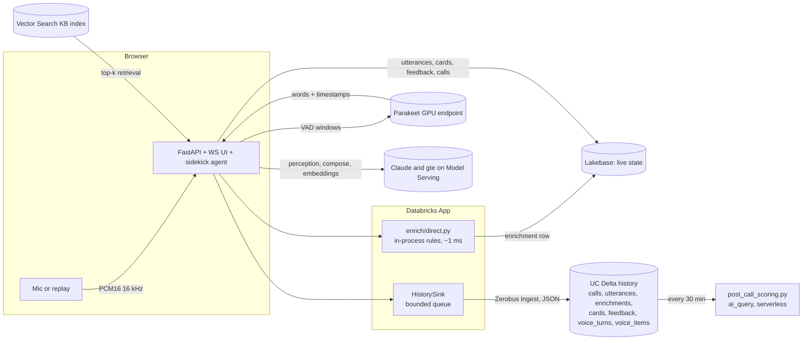

# Realtime Call Sidekick

Live call audio becomes sub-second transcripts. The app enriches each final utterance and turns it into
suggestion cards for the agent or advisor, pushed over WebSocket. Two-way voice mode runs in the same app.
Contract: [`docs/SPEC.md`](docs/SPEC.md). Architecture, both backbones, latency budget and switching:
[`docs/ARCHITECTURE.md`](docs/ARCHITECTURE.md).

## Architecture

The default backbone is **direct**: no Kafka. The app enriches each final in process, keeps live state in
Lakebase, and writes history to Delta through **Zerobus Ingest**.



ASCII summary:

```
direct (default)   final ─► enrich in process ─► Lakebase (live) ─► cards over WS
                       └──► HistorySink ─► Zerobus ─► UC Delta (history)            no broker, no RTM
kafka (scale mode) final ─► Kafka utterances ─► RTM job (classic) ─► Lakebase ─► NOTIFY ─► cards
                       └──► Kafka cards ─► delta_history.py (5 s) ─► UC bronze      needs classic workspace
```

## Which backbone?

| | direct (default) | kafka (scale mode) |
|---|---|---|
| Use for | demos, POCs, most customers | customers on Kafka/Event Hubs/MSK, fan-out, many concurrent calls |
| Broker | none | required |
| Classic compute | not needed (serverless) | RTM and history job need classic |
| Deploy | `scripts/deploy.sh <profile> <catalog>` | `BACKBONE=kafka scripts/deploy.sh ...` (bundle target `kafka`) |

Full comparison, latency budget and cost table: [`docs/ARCHITECTURE.md`](docs/ARCHITECTURE.md).

## Quickstart (local, no Databricks)

```bash
uv venv .venv --python 3.11
uv pip install -r src/app/requirements.txt -r tests/app/requirements-dev.txt --python .venv/bin/python
cd src/app && MODE=local uvicorn main:app --port 8000        # direct backbone, memory store and history
```

Local mode uses the in-memory store, the in-memory history sink, and no bus. Set `DATABRICKS_CONFIG_PROFILE`
to a workspace profile to use its LLM endpoints (e2-demo in our tests). Without it, the LLM is off and cards use
templates.

`BACKBONE=kafka MODE=local` runs the scale-mode code path locally: an in-memory bus stands in for Kafka and
`enrich/direct.py`'s `BusEnricher` stands in for RTM.

## Deploy

Deployment is one script. Prerequisites: the Databricks CLI with a profile for the target workspace, `jq`,
`openssl`, and permission to create apps, jobs, UC schemas and secret scopes, plus serving endpoints if you want voice.

### Direct backbone (default)

Create the Zerobus service principal first (Workspace access entitlement), then:

```bash
export DATABRICKS_CONFIG_PROFILE=<profile>
export ZEROBUS_ENDPOINT=<workspace-id>.zerobus.<region>.cloud.databricks.com   # from the workspace
export ZEROBUS_CLIENT_ID=<service principal application id>
export ZEROBUS_CLIENT_SECRET=<oauth secret>        # read from your vault, never commit it
scripts/deploy.sh <profile> <catalog>               # BACKBONE=direct is the default
```

The script writes the Zerobus values to the secret scope (`call-sidekick` by default; `zerobus_client_secret` is never
printed), validates and deploys the `dev` bundle target, runs the setup job (Lakebase tables), runs `init_history`
(the seven Zerobus tables and the MODIFY+SELECT grant), deploys and starts the app, and builds the KB index.
No Kafka secrets are needed. Kafka keys get placeholders because the app's resources bind them at deploy time.

Voice mode (adds two always-on GPU endpoints, see below):

```bash
DEPLOY_VOICE=1 scripts/deploy.sh <profile> <catalog>      # registers Parakeet and Kokoro before the app binds them
scripts/warmup_voice.py --profile <profile>              # before a demo, if GPU_SCALE_TO_ZERO=true (default)
```

### Kafka backbone (scale mode)

Requires a **classic** workspace (RTM and the history job run on classic compute). Create the Kafka secrets
first (values never go in git), then deploy with the `kafka` target:

```bash
databricks secrets create-scope call-sidekick
databricks secrets put-secret call-sidekick kafka_bootstrap
databricks secrets put-secret call-sidekick kafka_api_key          # jobs user (not MSK IAM)
databricks secrets put-secret call-sidekick kafka_api_secret
databricks secrets put-secret call-sidekick kafka_app_api_key      # app user (not MSK IAM)
databricks secrets put-secret call-sidekick kafka_app_api_secret

BACKBONE=kafka scripts/deploy.sh <profile> <catalog> SASL_SSL_PLAIN   # or SASL_SSL_SCRAM_SHA_256 / SASL_SSL_MSK_IAM
```

This adds the RTM cluster (`call-sidekick-rtm`), the RTM job (`call-sidekick-rtm-enrich`, continuous), the
Delta history job (`call-sidekick-delta-history`, continuous), and the Kafka topics. Stop the RTM job when no
calls are live: `databricks jobs list-runs --active-only` then `databricks jobs cancel-run <run_id>`. It has no
timeout by design.

### Manual equivalent

```bash
databricks bundle validate --strict --target dev --profile <profile>
databricks bundle deploy --target dev --profile <profile>
databricks bundle run call_sidekick_setup --target dev
databricks bundle run call_sidekick_init_history --target dev        # direct
databricks bundle run call_sidekick_app --target dev
databricks bundle run call_sidekick_kb_index --target dev
# voice only: databricks bundle run call_sidekick_parakeet_register --target dev  (and kokoro), then deploy again
```

Restart the app once after the first setup so it reads the real Lakebase secrets:
`databricks apps stop call-sidekick && databricks apps start call-sidekick`.

## Serverless and classic compute

The target workspace is serverless. Direct-mode jobs (setup, init_history, KB index, post-call scoring, and the
two GPU registrations) run on **serverless** compute with `environment_version` `6`. The GPU registrations use
`compute.hardware_accelerator: GPU_1xA10` on serverless GPU, as in the reference audio notebooks
(`reference/custom-llm-serving-solutions/audio-serving/kokoro-tts/01-serving.ipynb`, "Standard v6", A10).

Kafka-only pieces need classic compute: the RTM cluster (DBR 18.3, fixed workers, Photon off, DBR 16.4+ for Kafka RTM),
and the Delta history job cluster. Real-Time Mode does not run on serverless.

## GPU endpoints and scale-to-zero

Parakeet (STT) and Kokoro (TTS) are Custom LLM Serving endpoints on A10G. `gpu_scale_to_zero` (bundle variable;
`GPU_SCALE_TO_ZERO=true|false` for `deploy.sh`) controls scale-to-zero. **Default is `true` for dev cost.**

- With scale-to-zero on, the first voice turn after idle waits for a cold GPU. We measured about 156 s for a cold whisper
  endpoint on e2-demo. Run `scripts/warmup_voice.py --profile <p>` a few minutes before a demo. It pings both
  endpoints and prints time-to-ready.
- For real demos and latency measurements, deploy with `GPU_SCALE_TO_ZERO=false`. Both endpoints then stay up and bill
  continuously. Target latencies (SPEC 9.5) assume warm endpoints.

## Latency

Targets are in SPEC 7 and 9.5. Measured numbers and their labels are in [`docs/ARCHITECTURE.md`](docs/ARCHITECTURE.md) §3.
On the direct backbone, live replay on e2-demo (2026-10-30) measured in-process enrichment p50 0 ms (max 3 ms).
Customer final to card.start was p50 301 ms (`advisor_coach/fee_objection`) and 1002 ms (`contact_center/billing_dispute`).
Card.done was p50 1992 ms and 2299 ms. Small samples (n = 5–7 cards).

## Secrets and app env

Values never live in git. `deploy.sh` writes the scope keys; `resources/app.yml` binds them as app secret resources,
and `src/app/app.yaml` maps them to env vars with `valueFrom`.

| Env var | Resource name | Scope key | Backbone |
|---|---|---|---|
| `BACKBONE` | `backbone` | `backbone` (written by deploy.sh) | both |
| `LAKEBASE_HOST`, `_DB`, `_USER`, `_PASSWORD` | `lakebase-host`, `-db`, `-user`, `-password` | `lakebase_*` (setup job) | both |
| `ZEROBUS_ENDPOINT`, `ZEROBUS_CLIENT_ID`, `ZEROBUS_CLIENT_SECRET` | `zerobus-endpoint`, `zerobus-client-id`, `zerobus-client-secret` | `zerobus_*` | direct |
| `HISTORY_CATALOG`, `HISTORY_SCHEMA` | `history-catalog`, `history-schema` | `history_catalog`, `history_schema` | direct |
| `KAFKA_BOOTSTRAP_SERVERS`, `KAFKA_SECURITY`, `KAFKA_USERNAME`, `KAFKA_PASSWORD` | `kafka-*` | `kafka_*` (placeholders in direct) | kafka |
| `STT_ENDPOINT`, `FAST_MODEL`, `SMART_MODEL`, `EMBED_MODEL`, `TTS_ENDPOINT`, `VOICE_MODEL` | serving endpoint resources | (bundle variables) | both |

Defaults in `src/app/config.py`: `VOICE_MODEL=databricks-claude-haiku-4-5` (fastest first token measured on e2-demo;
re-measure in region), `FAST_MODEL=databricks-claude-haiku-5-5`, `SMART_MODEL=databricks-claude-sonnet-5-5`.

## Zerobus history (direct backbone)

The app writes history with the official **Zerobus Ingest** Python SDK (`databricks-zerobus-ingest-sdk`, `zerobus.sdk.sync`).
Facts checked against the docs and the SDK 1.10.0 package:

- Endpoint `<workspace-id>.zerobus.<region>.cloud.databricks.com`. Auth is a service principal client id and secret
  (OAuth). The principal needs the Workspace access entitlement.
- Target tables must already exist as UC managed Delta tables. `init_history.py` creates them. It grants
  `USE CATALOG`, `USE SCHEMA`, and `MODIFY, SELECT` on each table, which the docs list as required.
- JSON record mode: one JSON string per record. `ingest_record_offset` (not the deprecated `ingest_record`). Acks mean
  durable, not yet queryable.
- Column types: STRING, INT, BIGINT, DOUBLE, BOOLEAN. JSON-valued columns are STRING. Times are epoch milliseconds.

Sources: [Zerobus Ingest](https://docs.databricks.com/aws/en/ingestion/zerobus-ingest),
[message blocking and acknowledgment](https://docs.databricks.com/aws/en/ingestion/zerobus-message-blocking),
[Python SDK README](https://github.com/databricks/zerobus-sdk/blob/main/python/README.md).

The sink (`src/app/history/zerobus.py`) never blocks the call. `emit()` appends to a bounded queue (10 000 records,
drop-oldest, counted). A background task flushes batches (500 records or 0.5 s) through worker threads, one stream
per table. Missing credentials disable the sink with one log line. Failed batches are counted, and the stream is
recreated for the next batch. `/healthz` reports `history.queue_depth`, `dropped`, `failed`, and `written`.

## Kafka backbone: RTM restrictions (verified)

Checked against Databricks docs when written. Re-check before a production release.

| Constraint | Status | Source |
|---|---|---|
| Sources: Kafka, Event Hubs (Kafka API), Kinesis. AWS MSK is source-only. Delta is not a source or sink. | supported | [RTM reference](https://docs.databricks.com/aws/en/structured-streaming/real-time/reference) |
| Sinks: Kafka, Event Hubs, `forEach`. Native Lakebase `format("postgresql")` on DBR 18+. | supported | RTM reference; [Lakebase sink](https://docs.databricks.com/aws/en/structured-streaming/lakebase) |
| Output mode `update` only | constraint | RTM reference |
| `foreachBatch` not supported (`forEach` is). `rtm_enrich.py` uses the native sink. | constraint | RTM reference |
| UDFs: enrichment uses built-in functions only (a test asserts no Python UDF in the plan) | design | `tests/notebooks/test_enrich_rules.py` |
| Delta source/sink not supported for RTM. Bronze writes are `delta_history.py`. | constraint | RTM reference |
| Classic cluster, Dedicated or Standard access mode, DBR 16.4+ (Kafka), Photon off, autoscaling off, `spark.databricks.streaming.realTimeMode.enabled=true` | constraint | [RTM setup](https://docs.databricks.com/aws/en/structured-streaming/real-time/setup) |
| Serverless: not supported for RTM | constraint | RTM reference |
| Trigger `realTime="5 minutes"` is a checkpoint interval, not a delay | semantics | RTM setup |

Design choices in kafka mode: built-in functions only in the RTM job (`rlike`, `regexp_extract_all`, `from_json`,
`to_json`); one shared rules file (`src/notebooks/enrich_rules.json`, byte-identical to the app copy); upsert on
`(call_id, seq)`; JSON-valued enrichment columns are TEXT; separate clusters for RTM and batch so batch never takes RTM
task slots.

Kafka auth: `SASL_SSL_PLAIN` (Confluent), `SASL_SSL_SCRAM_SHA_256` / `_512` (Redpanda Cloud), `SASL_SSL_MSK_IAM`
(MSK, jobs only; the app producer needs a user/password mode). `scripts/kafka_smoke.py <env-file>` checks connectivity and least privilege.

## Voice mode (Sidekick, talk to it)

Two-way voice in the same app: Parakeet for speech in, Claude for the reply, Kokoro for speech out. Two roles:
**assistant** (ask Sidekick before, during or after a call) and **practice** (Sidekick plays the customer).

- **Streamed input (default).** The mic sends 100 ms PCM16 frames while open. Partials appear as you speak, and the
  endpoint (700 ms of silence) starts the reply. Push to talk flushes on release. Mute discards what you were saying.
  `?stream=0` falls back to one WAV per turn.
- **Live while you talk.** A sentiment gauge and sparkline (rules, no LLM), the methodology checklist in assistant mode,
  and provisional suggestion chips from one fast-model pass per 2.5 s. Pin a chip to keep it as an outcome. Chips give
  way to the end-of-turn list when the turn ends.
- **Keys.** Space: hold to talk (push-to-talk mode). M: mute. Esc: interrupt Sidekick.
- **Cold endpoints.** A scaled-to-zero STT or TTS endpoint shows "Warming up voice (GPU starting)" with a clock and
  retries with backoff (up to 90 s) instead of failing the turn.
- **Limits.** 30 minutes per socket, 20 voice sessions per app instance (HTTP 429 beyond that), 30 s per turn.
  `/healthz` reports endpoint readiness (cached 30 s).
- **Local mock.** `?mock=1&voice=assistant|practice&autostart=1` runs the whole console with simulated speech,
  partials, live analysis and suggestions (add `&warm=1` to see the warming banner).

The wire contract is in `docs/SPEC.md` sections 9.2a, 9.6 and 9.7. Logs are JSON lines on `sidekick.voice`, keyed by
session and turn, with no transcript text at INFO.

## Repository layout

```
databricks.yml                 bundle variables; targets: dev (direct, default), kafka (adds RTM + history job)
resources/
  lakebase.yml                 Lakebase project, UC schema, checkpoint volume
  job.yml                      serverless jobs: setup, init_history, kb_index, post_call_scoring, GPU registrations
  app.yml                      Databricks App and its secret and serving-endpoint resources
src/app/                       FastAPI app (bundle source_code_path)
  config.py                    settings; BACKBONE, HISTORY_BACKEND validated together
  enrich/direct.py             in-process enrichment (direct) and the RTM stand-in (kafka local)
  history/                     HistorySink: zerobus.py (Zerobus Ingest), memory.py (memory, none), schema.py (contract)
  bus/                         null.py (direct), memory.py (local kafka stand-in), kafka.py (kafka)
  store/                       lakebase.py (live state), memory.py
src/notebooks/
  init.py                      Lakebase role, SPEC 3.2 tables, NOTIFY trigger; Kafka topics only in kafka mode
  init_history.py              Zerobus history tables and grants (serverless)
  register_parakeet.py         Parakeet audio serving (Custom LLM task) → UC → GPU endpoint (serverless GPU)
  register_kokoro.py           Kokoro-82M TTS serving → UC → GPU endpoint (serverless GPU)
  build_kb_index.py            playbooks/kb → Delta → Vector Search index
  post_call_scoring.py         ai_query scoring → gold_call_scores (history tables; bronze in kafka mode)
  rtm_enrich.py, rtm_lib.py    kafka mode only: RTM job and its shared expressions
  delta_history.py             kafka mode only: Kafka → bronze Delta (micro-batch, not RTM)
scripts/deploy.sh             preflight, secrets, validate, deploy, ordered runs (BACKBONE, DEPLOY_VOICE, GPU_SCALE_TO_ZERO)
scripts/warmup_voice.py       ping Parakeet and Kokoro until both answer; prints time to ready
scripts/kafka_smoke.py        kafka mode: connectivity and least-privilege check
docs/SPEC.md                  contract (v0.4)
docs/ARCHITECTURE.md          the two backbones, latency budget, switching
```

## Tests

```bash
# App (local mode, no network, LLM faked)
.venv/bin/python -m pytest tests/app -q

# Notebooks and bundle YAML (Spark tests skip without pyspark)
uv venv /tmp/cc-venv --python 3.11
VIRTUAL_ENV=/tmp/cc-venv uv pip install -r tests/notebooks/requirements-dev.txt
/tmp/cc-venv/bin/python -m pytest tests/notebooks -q

# Lint (ruff.toml: pyflakes, E4/E7/E9, import order)
uvx ruff check src/app tests/app tests/notebooks scripts/*.py

# Frontend (bun; the Homebrew node install is broken on the dev laptop)
cd frontend && bun run typecheck && bun run build      # build writes src/app/static
```

CI (`.github/workflows/quality.yml`) runs the same suites and fails if the committed `src/app/static` is stale.
`ruff check .` over the whole repo also reports `dbutils`/`spark` globals in notebooks. Those are runtime
globals in Databricks notebooks, not defects, and they predate this change.

The Spark tests need Java 17 and the stock PyPI `pyspark==3.5.1`.
